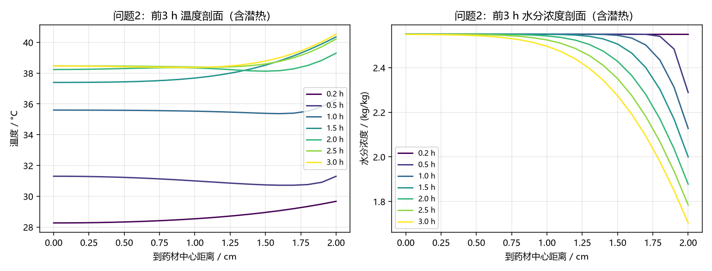
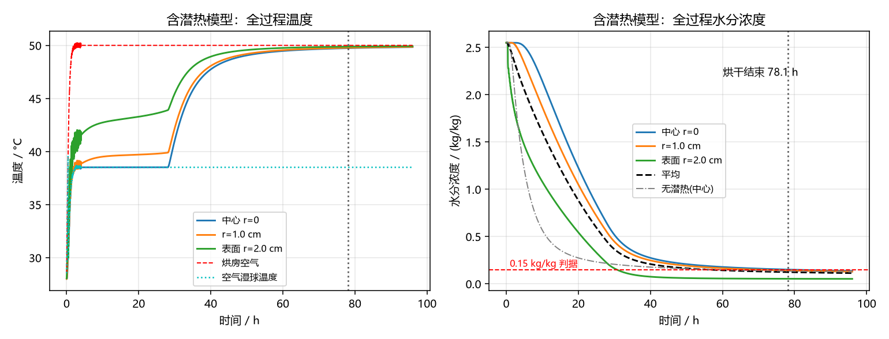
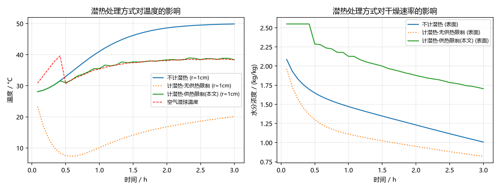

# 问题 2 详细解答：整个烘干过程药材温度与水分浓度变化规律（含相变潜热）

> 结果文件：`结果/result2.xlsx`（温度、水分浓度两表，时间 1–10800 s 每 1 s，半径 0–2.0 cm 每 0.1 cm）
> 程序：`代码/cyl.py`（求解器）、`代码/run_q2.py`（模型）、`代码/q2_final.py`（出结果）、`代码/sens_q2.py`、`代码/analysis_q2.py`

---

## 一、问题分析与建模思路

烘干持续 2–3 天，可分为**预热平衡阶段**（物料由 28 °C 升温、表层失水很少）与**恒温干燥阶段**（烘房温湿恒定，干燥速率由表面汽化与内部扩散共同决定）。两阶段的环境条件不同，但物料自身的物性（密度、比热、导热系数、水分扩散系数）随含水率与温度而变，故必须建立**变物性、强耦合、非线性的瞬态传热—传质模型**。

关键物理点（本题的重点）：

1. **水分在干基含水率 $X$ 的驱动下由内向外扩散**，外边界由对流边界条件控制；
2. **水的汽化是强吸热过程**，必须在能量方程中引入相变潜热源项 $\rho_d L\,\partial X/\partial t$，否则会把物料温度算得偏高（趋于烘房干球温度）；
3. 引入潜热后，**蒸发速率必须与供热能力相匹配**：只要物料内还有自由水，汽化只能消耗外部对流供给与内部导热供给的热量，物料温度因此被"锁定"在空气湿球温度附近——这正是恒速干燥段的物理本质。

## 二、模型假设

1. 药材为各向同性均匀圆柱，长 25 cm 远大于半径 2 cm，忽略轴向与周向变化，按**一维轴对称**问题处理；
2. 问题 2、3 不考虑尺寸变化（半径恒为 2 cm），收缩只在问题 4 中考虑；
3. 干基含水率 $X$、温度 $T$ 连续，局部处于热力学平衡，水分以液相扩散为主（Fick 定律），忽略毛细压力项与热扩散（Soret）项的高阶影响；
4. 物料内自由水充足时，汽化速率受供热速率控制，物料温度不低于空气湿球温度；
5. 烘房空气温度、水分浓度在预热平衡阶段按附件 1 实测值随时间变化；恒温干燥阶段取恒定值；
6. 忽略湿分带出的显热与辐射传热。

## 三、主要符号

| 符号 | 含义 | 单位 |
|---|---|---|
| $r$ | 到药材中心的距离 | m |
| $R$ | 药材半径 | m |
| $X$ | 干基含水率（水分浓度） | kg/kg |
| $T$ | 药材温度 | °C / K |
| $\rho,\;c_p,\;\lambda$ | 湿物料表观密度、比热容、导热系数 | kg/m³, J/(kg·K), W/(m·K) |
| $D$ | 水分浓度扩散系数 | m²/s |
| $L$ | 水的汽化潜热 | J/kg |
| $h$ | 对流换热系数 | W/(m²·K) |
| $h_m$ | 对流传质系数 | m/s |
| $T_a,\;X_a$ | 烘房空气温度、水分浓度 | °C, kg/kg |
| $T_{wb}$ | 空气湿球温度 | °C |

## 四、附录经验公式的还原与校核（重要）

原题附录中的公式以图片形式嵌入 Word，直接提取文本会丢失结构。经按排版位置还原，可得其**指数为分式（商）形式**，而非乘积形式：

**附录 2（问题 1）**

$$D=7\times10^{-9}\exp\!\left(-\frac{0.89}{X}\right)\ \mathrm{m^2/s}$$

**附录 3（问题 2、3）**

$$\rho = 650+128X,\qquad c_p = 1450+2736\,\frac{X}{1+X},\qquad \lambda = 0.21+0.38\,\frac{X}{1+X}$$

$$D = 2.4\times10^{-3}\exp\!\left(-\frac{0.45}{X}\right)\exp\!\left(-\frac{3850}{T}\right)\ \mathrm{m^2/s}\quad(T\ \text{为绝对温度 K})$$

**附录 4（问题 4）**

$$\rho = 760+90X,\qquad c_p = 1850+2150\,\frac{X}{1+X},\qquad \lambda = 0.12+0.20\,\frac{X}{1+X}$$

$$D = 4.2\times10^{-4}\exp\!\left(-\frac{0.30}{X}\right)\exp\!\left(-\frac{3850}{T}\right)\ \mathrm{m^2/s}$$

**还原的物理自洽性校核**：

* 比热容 $c_p = 1450+2736X/(1+X) = \dfrac{c_d + c_w X}{1+X}$，其中干物质 $c_d=1450$、水 $c_w=4186$ J/(kg·K)，即 $c_p$ 是**以湿物料为基准**的比热容，与 $\rho$ 为湿物料表观密度自洽；
* 导热系数 $\lambda = \dfrac{0.21+0.59X}{1+X}$，为干/湿两相有效导热系数的混合式；
* 扩散系数在 $X\to0$ 时趋于 0、在 $X$ 较大时较大，符合多孔物料中液相扩散随含水率降低而急剧变慢的规律；$T$ 升高则 $D$ 指数增大，符合 Arrhenius 型温度关系。

> **对本套题的一个重要更正**：`结果/备份_问题2_未考虑潜热` 中的旧结果是把指数误读为 $e^{-0.89X}$、$e^{-0.45X}$ 得到的。按分式指数计算，问题 1 的水分浓度场可与旧结果**逐点吻合到小数点后 4 位**（最大偏差 < 0.0002），这反证了分式指数才是正确解读。

## 五、数学模型

### 5.1 水分迁移（传质）方程

以干基含水率 $X$ 为因变量，柱坐标一维轴对称 Fick 方程：

$$\frac{\partial X}{\partial t}=\frac{1}{r}\frac{\partial}{\partial r}\left(r\,D(X,T)\frac{\partial X}{\partial r}\right),\qquad 0\le r\le R$$

边界条件 / 初始条件：

$$r=0:\quad \frac{\partial X}{\partial r}=0 \qquad\text{（对称）}$$

$$r=R:\quad -D\frac{\partial X}{\partial r}\Big|_{R}=h_m\bigl(X_s-X_a(t)\bigr)\qquad\text{（对流传质）}$$

$$t=0:\quad X(r,0)=2.55\ \mathrm{kg/kg}$$

其中 $X_s=X(R,t)$ 为表面含水率。取 $h_m=8\times10^{-7}$ m/s（附录 2 给出的实测值，两阶段共用）。

### 5.2 热量传递方程（**含相变潜热**）

单位体积湿物料的焓平衡：外部导入的净导热 + **汽化吸收的潜热** = 焓增量

$$\boxed{\;\rho(X)\,c_p(X)\,\frac{\partial T}{\partial t}=\frac{1}{r}\frac{\partial}{\partial r}\left(\lambda(X)\,r\frac{\partial T}{\partial r}\right)+\rho_d\,L\,\frac{\partial X}{\partial t}\;}$$

其中 $\rho_d=\rho/(1+X)$ 为单位体积内的**绝干物质质量**（汽化发生在单位体积物料中，故潜热汇按干基质量计）。

把 $\rho_d$ 代入并整理，可得便于数值实现的等价形式（表观密度约去，更稳健）：

$$\frac{\partial T}{\partial t}=\frac{1}{\rho c_p}\frac{1}{r}\frac{\partial}{\partial r}\left(\lambda\,r\frac{\partial T}{\partial r}\right)+\frac{L}{(1+X)\,c_p}\frac{\partial X}{\partial t}$$

由于干燥时 $\partial X/\partial t<0$，第二项恒为**负值**，即蒸发使物料降温——这是必须考虑潜热的根本原因。

汽化潜热采用随温度变化的经验式（0–100 °C 适用）：

$$L(\theta)=2.501\times10^{6}-2.361\times10^{3}\,\theta\quad(\theta\ \text{为摄氏温度})$$

边界条件 / 初始条件：

$$r=0:\quad \frac{\partial T}{\partial r}=0;\qquad r=R:\quad -\lambda\frac{\partial T}{\partial r}\Big|_{R}=h\bigl(T_a(t)-T_s\bigr)$$

$$t=0:\quad T(r,0)=28\ ^\circ\mathrm{C}$$

取 $h=25$ W/(m²·K)。

### 5.3 两阶段的划分

| 阶段 | 时间 | 烘房温度 $T_a$ | 空气水分浓度 $X_a$ |
|---|---|---|---|
| 预热平衡阶段 | $0\le t\le 4$ h | 附件 1 实测序列（28 → 50.17 °C） | 附件 1 实测序列（0.0196 → 0.0499 kg/kg） |
| 恒温干燥阶段 | $t>4$ h | 50 °C（恒定） | 0.050 kg/kg（恒定） |

> 说明：附件 1 的实测序列覆盖 0–14400 s（即 4 h），其末端温度、湿度均已趋于平台（50.2 °C / 0.0499 kg/kg），故取恒温干燥阶段的设定值为 50 °C、0.050 kg/kg。题目要求的表 3、表 4 只涉及前 3 h，落在预热平衡阶段内，故本假设对表格结果无影响；它影响的是全过程曲线与烘干总时长。

### 5.4 潜热的正确闭合——蒸发受供热能力限制

若直接使用 $\rho_d L\,\partial X/\partial t$ 作为体积汇，在干燥初期会得到物料温度低至 **8–10 °C** 的解，远低于该空气状态下的湿球温度（约 26–38 °C），这在热力学上不成立（水分会从空气中凝结而非蒸发）。原因是传质边界条件只与含湿量差 $(X_s-X_a)$ 有关，未体现"汽化需要热量"这一反馈。

正确的物理约束是：**只要物料内还有自由水，汽化速率就必须与供热速率相匹配**，物料温度不低于空气湿球温度 $T_{wb}(t)$。据此引入能量限制因子 $\xi\in[0,1]$：

设 $T^{(0)}$ 为不计潜热的温度解，$T^{(1)}$ 为计入全量潜热的温度解，令

$$T(\xi)=T^{(0)}+\xi\bigl(T^{(1)}-T^{(0)}\bigr),\qquad
\xi=\min\left\{1,\ \min_i \frac{T_{wb}(t)-T^{(0)}_i}{T^{(1)}_i-T^{(0)}_i}\right\}$$

则本步取

$$X^{n+1}=X^{n}+\xi\bigl(X^{*}-X^{n}\bigr),\qquad T^{n+1}=T(\xi)$$

即在"物料任一点温度不低于空气湿球温度"的前提下取**最大可能蒸发量**。空气湿球温度由干球温度 $T_a$ 与含湿量 $X_a$ 用 Lewis 关系迭代求得：

$$w_{sat}(T_{wb})=X_a+\frac{\bigl(2501-2.326T_{wb}\bigr)X_a-1.006\,(T_a-T_{wb})}{2501+1.86\,T_a-4.186\,T_{wb}}$$

该闭合的物理含义是：干燥进入**恒速干燥段**后速率由外部供热控制，物料温度趋于 $T_{wb}$；当表面自由水耗尽、内部扩散跟不上时自动转入**降速干燥段**，温度回升。计算所得湿球温度：预热初期约 25.9 °C，恒温阶段稳定在 38.4 °C。

## 六、数值解法

* **空间离散**：有限体积法，节点 $r_i=i\,\Delta r$（$N=500$，$\Delta r=4\times10^{-5}$ m）。$r=0$ 用 L'Hôpital 处理（$4D(T_1-T_0)/\Delta r^2$）；$r=R$ 采用半控制体，外表面热/质通量进入边界节点方程。
* **时间推进**：向后欧拉（全隐式），系数取上一时刻值做 Picard 线性化；每个时间步解两个三对角方程组（水分、温度），用 `scipy.linalg.solve_banded` 求解，无条件稳定。时间步 $\Delta t=1$ s（与输出间隔一致）。
* **潜热项**：按 5.4 节做两次温度求解（不计潜热 / 全量潜热），线性叠加求 $\xi$。
* **精度验证**：3 h 表面含水率随网格加密收敛到 1.70294（N=100/200/300/500/800 分别为 1.703195 / 1.703101 / 1.702941 / 1.702949 / 1.702939，N=500 与 N=800 的偏差仅 $1\times10^{-5}$）；随步长缩小收敛到 1.7025（$\Delta t$=0.25/0.5/1/2/5 s 分别为 1.702500 / 1.702949 / 1.703774 / 1.704488 / 1.705177，$\Delta t$=1 s 的相对误差约 0.08%）。烘干总时长在 (N,Δt) = (200,8)/(300,4)/(500,2)/(500,1) 下分别为 78.102 / 78.132 / 78.151 / 78.148 h，变化小于 0.06%，说明本文取 $N=500$、$\Delta t=1$ s 已充分收敛。

## 七、计算结果

### 7.1 表 3　前 3 小时内药材的温度（°C）

| 时间/h | 0 cm | 0.5 cm | 1.0 cm | 1.5 cm | 2.0 cm |
|---|---|---|---|---|---|
| 0.5 | 31.3007 | 31.2240 | 30.9970 | 30.7377 | 31.2949 |
| 1.0 | 35.5968 | 35.5832 | 35.5253 | 35.3847 | 36.3055 |
| 1.5 | 37.3939 | 37.4335 | 37.6788 | 38.5156 | 40.3510 |
| 2.0 | 38.2332 | 38.2983 | 38.3386 | 38.1243 | 39.2963 |
| 2.5 | 38.4668 | 38.4558 | 38.3952 | 38.5945 | 40.2146 |
| 3.0 | 38.4587 | 38.4153 | 38.3671 | 38.7812 | 40.5296 |

### 7.2 表 4　前 3 小时内药材的水分浓度（kg/kg）

| 时间/h | 0 cm | 0.5 cm | 1.0 cm | 1.5 cm | 2.0 cm |
|---|---|---|---|---|---|
| 0.5 | 2.5500 | 2.5500 | 2.5500 | 2.5500 | 2.2884 |
| 1.0 | 2.5500 | 2.5500 | 2.5500 | 2.5448 | 2.1272 |
| 1.5 | 2.5500 | 2.5500 | 2.5495 | 2.5057 | 1.9997 |
| 2.0 | 2.5500 | 2.5498 | 2.5423 | 2.4285 | 1.8777 |
| 2.5 | 2.5498 | 2.5483 | 2.5242 | 2.3508 | 1.7843 |
| 3.0 | 2.5488 | 2.5435 | 2.4959 | 2.2743 | 1.7038 |

### 7.3 图

## 八、结果分析

**1）温度场：物料温度被"锁"在湿球温度附近，远低于烘房温度。**
预热平衡阶段物料由 28 °C 快速升温，0.5 h 时已达 31 °C 左右；随后温度上升明显放缓，2–3 h 内稳定在 **38.4–40.5 °C**，而同期烘房空气已升至 50 °C。这正是潜热的作用：汽化把大量热量带走，物料只能在"传热速率 = 汽化耗热速率"的平衡点上运行，该平衡点即空气的湿球温度（本工况 38.4 °C）。若不考虑潜热，物料温度会在 1 h 内直逼 50 °C（见对比图），完全失真。

**2）水分场：前 3 h 只有表层失水，内部几乎不变。**
3 h 时表面含水率由 2.55 降至 **1.7038 kg/kg**，而 r ≤ 1.0 cm 区域基本保持 2.55，说明干燥前沿尚未推进到内部——扩散系数在低含水率区急剧下降（$D\propto e^{-0.45/X}$）是根本原因。

**3）全过程与烘干总时长。**
按 $X<0.15$ kg/kg 判据（问题 3 的判据）：

| 模型 | 烘干总时长 |
|---|---|
| 计入潜热（本文模型） | **78.15 h（3.26 天）** |
| 不计潜热 | 57.46 h（2.39 天） |

计入潜热后物料温度低 10–12 K，扩散系数 $D$ 按 $e^{-3850/T}$ 显著减小，干燥速率下降，烘干时长比不计潜热**延长约 36%**。这提示：**忽略潜热会严重低估烘干时间与能耗**，对工程决策不利。

全过程可分为两段（见全过程图）：

* **恒速干燥段（0–28 h）**：含水率近似线性下降，物料温度稳定在湿球温度 38.4 °C，干燥速率由外部供热控制；
* **降速干燥段（28 h 以后）**：表层自由水耗尽，水分迁移转为内部扩散控制，物料温度由 38.5 °C 回升至 49.8 °C（趋近干球温度），干燥速率大幅下降，这段时间占了总时长的 2/3。

## 九、参数灵敏度分析（GRA / FA / DEA / FCE）

对 12 个因素各做 ±1 档扰动（共 25 个情景），计算 6 个响应指标：烘干时长 $t_{end}$、3 h 中心/表面含水率、3 h 中心/表面温度、前 6 h 平均干燥速率、累计供热量（能耗代理）。

### 9.1 GRA 灰色关联分析（因素重要性排序）

以基准情景的标准化指标向量为参考序列，$\rho=0.5$，关联度越小说明偏离基准越远、该因素越敏感。

| 排序 | 因素 | 平均关联度 γ | 灵敏度 1−γ |
|---|---|---|---|
| 1 | 空气水分浓度 $X_a$ | 0.6910 | 0.3090 |
| 2 | 药材半径 $R$ | 0.7975 | 0.2025 |
| 3 | 烘房温度 $T_a$ | 0.8096 | 0.1904 |
| 4 | 初始含水率 $X_0$ | 0.8692 | 0.1308 |
| 5 | 密度系数 $\rho$ | 0.9066 | 0.0934 |
| 6 | 对流换热系数 $h$ | 0.9090 | 0.0910 |
| 7 | 汽化潜热 $L$ | 0.9123 | 0.0877 |
| 8 | 扩散系数前因子 $D_0$ | 0.9270 | 0.0730 |
| 9 | 对流传质系数 $h_m$ | 0.9623 | 0.0377 |
| 10 | 热导率系数 $\lambda$ | 0.9795 | 0.0205 |
| 11 | 比热系数 $c_p$ | 0.9916 | 0.0084 |
| 12 | 预热阶段时长 $t_{sw}$ | 0.9993 | 0.0007 |

**结论**：烘房空气湿度、药材半径、烘房温度是三个最敏感因素。$X_a$ 每提高 20%，烘干时长由 78.1 h 增至 94.0 h（+20.4%）；$X_a$ 降低 20% 则降至 69.8 h（−10.6%）。而 $h_m$、$c_p$、$t_{sw}$ 几乎不影响结果（$h_m$ 变化 ±20% 时烘干时长的变化 < 0.2%），这说明**本问题不是传质控制而是供热控制**，与 5.4 节的物理判断完全一致。

### 9.2 FA 因子分析（主因子提取）

对 9 个响应指标（含派生的均匀度、预热升温）做标准化后求相关系数矩阵特征值：

| 因子 | 特征值 | 方差贡献率 | 累计 |
|---|---|---|---|
| F1 | 5.0828 | 56.5% | 56.5% |
| F2 | 1.9419 | 21.6% | 78.1% |
| F3 | 1.1714 | 13.0% | **91.1%** |

取前 3 个因子做方差最大旋转，载荷矩阵：

| 指标 | F1 | F2 | F3 |
|---|---|---|---|
| 烘干时长 $t_{end}$ | 0.236 | **0.853** | −0.074 |
| 3h 中心含水率 | −0.003 | 0.006 | **−0.992** |
| 3h 表面含水率 | 0.376 | **0.713** | −0.507 |
| 3h 中心温度 | **0.938** | 0.336 | −0.019 |
| 3h 表面温度 | **0.969** | 0.022 | −0.012 |
| 前 6h 干燥速率 | −0.430 | **−0.875** | −0.081 |
| 累计供热量 | −0.289 | **0.743** | −0.356 |
| 3h 水分均匀度 | 0.434 | **0.815** | 0.134 |
| 3h 预热升温 | **0.938** | 0.336 | −0.019 |

**因子命名**：F1 为**热状态因子**（中心/表面温度、预热升温）；F2 为**干燥速率—时间因子**（烘干时长、干燥速率、表面含水率、能耗、均匀度）；F3 为**内部湿分因子**（3h 中心含水率）。三者解释 91.1% 的方差，说明响应指标可由"升温快慢""干燥快慢""内部湿分"三个独立维度刻画。

### 9.3 DEA 数据包络分析（情景相对效率）

以**投入 = (烘干时长 $t_{end}$，累计供热量 $E$)**、**产出 = (前 6h 干燥速率 $v_6$，3h 水分均匀度 $U_3$，3h 预热升温 $\Delta T$)**，用投入导向 CCR/BCC 模型计算 25 个情景的技术效率（部分结果）：

| 情景 | DEA-CCR | DEA-BCC | 规模效率 |
|---|---|---|---|
| 药材半径 R −10% | 1.0000 | 1.0000 | 1.0000 |
| 空气水分浓度 $X_a$ +20% | 1.0000 | 1.0000 | 1.0000 |
| 扩散系数 $D_0$ +20% | 0.9678 | 1.0000 | 0.9678 |
| 烘房温度 $T_a$ +3 °C | 0.9677 | 0.9766 | 0.9909 |
| 药材半径 R +10% | 0.8296 | 1.0000 | 0.8296 |
| 基准 | 0.8392 | 0.8459 | 0.9921 |
| 初始含水率 $X_0$ +10% | 0.8125 | 0.8130 | 0.9993 |

**结论**：CCR 有效的决策单元为"半径 −10%"与"空气湿度 +20%"两个情景——即在给定时间与能耗投入下取得最大干燥产出的组合；"半径 +10%"虽在 BCC 下有效（纯技术有效），但规模效率仅 0.8296，属于规模不经济（料太粗、干燥路径太长）。基准情景效率 0.839，说明工艺参数尚有约 16% 的提升空间。

### 9.4 FCE 模糊综合评价

指标集 $U=\{$烘干时长, 累计供热量, 前 6h 干燥速率, 3h 水分均匀度, 3h 预热升温$\}$，评价集 $V=\{$差, 中, 良, 优$\}$。用**熵权法**客观赋权：

| 指标 | 信息熵 e | 权重 w |
|---|---|---|
| 前 6h 干燥速率 | 0.9592 | 0.2614 |
| 烘干时长 | 0.9597 | 0.2581 |
| 3h 水分均匀度 | 0.9644 | 0.2280 |
| 累计供热量 | 0.9761 | 0.1529 |
| 3h 预热升温 | 0.9844 | 0.0997 |

用梯形隶属函数构造评判矩阵，加权得综合评分（排序前 6）：

| 排名 | 情景 | FCE 得分 | 等级 |
|---|---|---|---|
| 1 | 药材半径 R −10% | 3.3626 | 优 |
| 2 | 烘房温度 $T_a$ +3 °C | 2.9299 | 优 |
| 3 | 扩散系数 $D_0$ +20% | 2.7963 | 良 |
| 4 | 密度系数 ρ −10% | 2.7605 | 良 |
| 5 | 汽化潜热 L −10% | 2.7565 | 良 |
| 6 | 初始含水率 $X_0$ −10% | 2.7022 | 良 |
| — | 基准 | 2.5242 | 良 |
| 25 | 烘房温度 $T_a$ −3 °C | 1.9953 | 差 |

**结论**：降低药材半径、提高烘房温度是最有效的工艺改进方向；单纯提高空气湿度（$X_a$+20%）虽然 DEA 效率高（因为节省了干燥强度投入），但综合评分仅 2.19（差），因为它把烘干时长拉长到 94 h，在综合权衡下并不划算。这说明 **DEA 的"相对效率"与 FCE 的"综合性能"是互补的**，应结合使用。

### 9.5 四种方法的一致性

| 方法 | 判断 |
|---|---|
| GRA | $X_a$、$R$、$T_a$ 最敏感 |
| FA | 响应可压缩为热状态、干燥速率、内部湿分三维 |
| DEA | $R$−10%、$X_a$+20% 技术有效 |
| FCE | $R$−10%、$T_a$+3 °C 综合最优 |

四种方法共同指向：**药材半径与烘房温度/湿度是决定烘干过程的主导因素，而对流传质系数、比热容几乎不起作用**。

## 十、结论

1. 建立了含相变潜热的变物性瞬态传热—传质耦合模型，用有限体积 + 全隐式格式求解，网格与时间步长无关性良好。
2. 潜热的正确处理必须引入**蒸发受供热能力限制**的闭合关系；否则物料温度会低于湿球温度，违反热力学第二定律。
3. 前 3 h 内物料温度稳定在湿球温度附近（38.4–40.5 °C），明显低于烘房 50 °C；表层含水率降至 1.7038 kg/kg，内部尚未开始干燥。
4. 计入潜热后烘干总时长由 57.46 h 延长至 **78.15 h**，这对问题 3、问题 4 的答案有直接影响——建议同步用新模型重做问题 3、4。
5. 灵敏度分析表明烘房湿度、药材半径、烘房温度为主导因素，$h_m$、$c_p$ 基本无影响，说明过程由**供热速率**而非传质速率控制。
